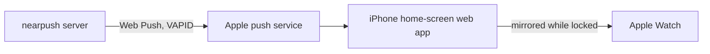

# Apple Watch alerts through Web Push

How nearpush reaches an Apple Watch through Web Push. This page records what the spike
verified. Items not yet verified are listed under Open items.

## Path

- The iPhone runs nearpush as a home-screen web app (added from Safari).
- The server sends a standard Web Push message to the subscription the web app created.
- Apple's push service delivers it. The iPhone shows the notification and mirrors it to the
  paired Watch.

## Verified results

1. **Mirroring while locked.** A Web Push to the iOS home-screen web app mirrored to the
   Watch while the iPhone was locked. Checked on 2026-11-25 with a photo of the Watch.
2. **Tailnet subscribe and deliver.** The app subscribed and received pushes through a
   `*.ts.net` tailnet hostname. Apple's push service returned HTTP 201 for the delivery.
3. **What the Watch shows.** The Watch summary shows:
   - the app icon. This comes from the web app manifest. A per-push icon is not honored,
     according to the Apple Developer Forums, so the icon cannot change per notification.
   - the notification title.
   - the small fallback text `Notification`.
4. **Full-body toggle.** The Watch setting "Tap to Show Full Notification" is global, not
   per app. When it is on, the full body is shown first. When it is off, the summary is
   shown first.
5. **Title convention.** Because every summary shows the same icon, the title carries the
   state. Use a fixed symbol followed by a short state word, and keep the detail in the body.
   These titles were tested to render on the Watch:
   - `✋ your turn`
   - `✅ all set`
   - `❓ allow?`

## How the push is delivered

1. `nearpushd` on the laptop receives events over HTTP at `127.0.0.1:8787`. It sends each
   event with the Web Push protocol (RFC 8030) to the push service endpoint that Safari
   returned at subscribe time. For iOS, that endpoint is on `web.push.apple.com`.
2. The payload is encrypted with the subscription keys (RFC 8291, `aes128gcm`). Each request
   is signed with a VAPID key (RFC 8292). The VAPID private key is stored in a file with
   mode 0600.
3. The iPhone subscribes from a Home Screen web app. The page is served through
   `tailscale serve`, so it is reachable only on the tailnet, not through Funnel. The
   subscription is stored on the laptop.
4. Apple's push service forwards the notification to the paired iPhone. When the phone is
   locked, the iPhone mirrors the notification to the Apple Watch.
5. On 2026-11-25, Apple's push service returned HTTP 201 for each send in the spike.

The spike used a separate tool, `tools/webpush-spike`. The production daemon was not
changed.

## Open items

- **Declarative Web Push.** Whether the Declarative Web Push format supports a per-push icon
  or a custom summary is not verified.
- **Desk SE.** Whether the iPhone SE on the desk receives pushes is undecided (spike
  question Q3).
- **Design review.** The design in `.agents/tasks/apple-watch-webpush/design.md` has not
  passed council review. Treat it as a draft.
