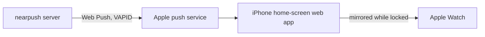

# Apple Watch alerts through Web Push

How nearpush reaches an Apple Watch through Web Push. This page records what the spike
verified. Items not yet verified are listed under Open items.

The spike server is throwaway. The production daemon does not send Web Push yet, so the
Setup steps below test the path by hand.

## Path



- The iPhone runs nearpush as a home-screen web app (added from Safari).
- The server sends a standard Web Push message to the subscription the web app created.
- Apple's push service delivers it. The iPhone shows the notification and mirrors it to the
  paired Watch.

## Verified results

1. **Mirroring while locked.** A Web Push to the iOS home-screen web app mirrored to the
   Watch while the iPhone was locked. Checked on 2026-11-25 with a photo of the Watch.
2. **Tailnet subscribe and deliver.** The app subscribed and received pushes through a
   `*.ts.net` tailnet hostname. Apple's push service returned HTTP 201 for the delivery.
3. **What the Watch shows.** The Watch summary shows:
   - the app icon. This comes from the web app manifest. A per-push icon is not honored,
     according to the Apple Developer Forums, so the icon cannot change per notification.
   - the notification title.
   - the small fallback text `Notification`.
4. **Full-body toggle.** The Watch setting "Tap to Show Full Notification" is global, not
   per app. When it is on, the full body is shown first. When it is off, the summary is
   shown first.
5. **Title convention.** Because every summary shows the same icon, the title carries the
   state. Use a fixed symbol followed by a short state word, and keep the detail in the body.
   These titles were tested to render on the Watch:
   - `✋ your turn`
   - `✅ all set`
   - `❓ allow?`

## How the push is delivered

1. `nearpushd` on the laptop receives events over HTTP at `127.0.0.1:8787`. It sends each
   event with the Web Push protocol (RFC 8030) to the push service endpoint that Safari
   returned at subscribe time. For iOS, that endpoint is on `web.push.apple.com`.
2. The payload is encrypted with the subscription keys (RFC 8291, `aes128gcm`). Each request
   is signed with a VAPID key (RFC 8292). The VAPID private key is stored in a file with
   mode 0600.
3. The iPhone subscribes from a Home Screen web app. The page is served through
   `tailscale serve`, so it is reachable only on the tailnet, not through Funnel. The
   subscription is stored on the laptop.
4. Apple's push service forwards the notification to the paired iPhone. When the phone is
   locked, the iPhone mirrors the notification to the Apple Watch.
5. On 2026-11-25, Apple's push service returned HTTP 201 for each send in the spike.

The spike used a separate tool, `tools/webpush-spike`. The production daemon was not
changed.

## Setup

This procedure runs the spike server on a laptop and sends test pushes to an iPhone and
Apple Watch. Use placeholders as written. Do not paste real email addresses, tailnet names,
IP addresses, keys, or tokens into the repo or into issues.

### Prerequisites

- An iPhone on iOS 16.4 or later with an Apple Watch paired to it. The spike was verified
  on iOS 18.7.
- Tailscale on the laptop and on the iPhone, both signed in to the same tailnet and
  connected. `tailscale serve` with HTTPS needs MagicDNS and HTTPS certificates enabled in
  the tailnet admin console.
- Python 3 with `pywebpush` (the spike used 2.5.0). `cryptography` installs with it.
- The spike code. `tools/webpush-spike` is on the `apple-watch-webpush-spike` branch, not on
  `main`:

  ```bash
  git fetch <remote> apple-watch-webpush-spike
  git switch apple-watch-webpush-spike
  ```

- A virtual environment with the dependency:

  ```bash
  python3 -m venv ~/.venvs/nearpush-spike
  ~/.venvs/nearpush-spike/bin/pip install pywebpush==2.5.0
  ```

### 1. Create the VAPID key pair

VAPID is the key pair that identifies the sender to Apple's push service. The server creates
the private key on first start when the file is missing. You can create it yourself first,
so the file mode is set before the server runs:

```bash
export NEARPUSH_SPIKE_STATE="$HOME/.local/share/nearpush-webpush-spike/state"
mkdir -p -m 700 "$NEARPUSH_SPIKE_STATE"
(umask 077 && openssl ecparam -name prime256v1 -genkey -noout \
  | openssl pkcs8 -topk8 -nocrypt -out "$NEARPUSH_SPIKE_STATE/vapid_private.pem")
chmod 600 "$NEARPUSH_SPIKE_STATE/vapid_private.pem"
ls -l "$NEARPUSH_SPIKE_STATE/vapid_private.pem"   # expect -rw-------
```

The command writes the key straight to the file and prints nothing. Keep the state directory
outside the repo. Never print, copy, or commit the `.pem` file. The server serves only the
public half, at `/vapid`.

### 2. Set the VAPID contact

```bash
export NEARPUSH_SPIKE_SUBJECT=mailto:<your-email>
```

This variable is required. The server exits without it. Apple receives the value as the
`sub` claim in every VAPID token, so use an address you are willing to give to Apple.

### 3. Start the server

```bash
~/.venvs/nearpush-spike/bin/python tools/webpush-spike/server.py serve
```

The server listens on `127.0.0.1:<port>`. The port is the `PORT` constant in `server.py`
(8797 in the spike). The spike does not read a port setting, so change the constant in the
code if you need another port. The server runs in the foreground and prints one JSON line
per request.

### 4. Expose the server on the tailnet only

In a second terminal:

```bash
tailscale serve --bg --https=<https-port> http://127.0.0.1:<port>
tailscale serve status
```

The page is now at `https://<tailnet-host>:<https-port>/`, where `<tailnet-host>` is the
laptop's `*.ts.net` name. Use `serve` only. Do not use `tailscale funnel`: Funnel makes the
page reachable from the public internet. The spike does not check who calls it, so the
tailnet is the only access control. Confirm that `tailscale funnel status` shows nothing
enabled for this port.

To stop exposing the page:

```bash
tailscale serve --https=<https-port> off
```

### 5. Add the page to the iPhone Home Screen

1. On the iPhone, make sure Tailscale is connected. Open Safari and go to
   `https://<tailnet-host>:<https-port>/`.
2. Tap Share, then **Add to Home Screen**.
3. Close the Safari tab. Open the new icon from the Home Screen. Web Push works only in the
   Home Screen app, not in a Safari tab.
4. The page prints diagnostic lines. Check that it shows `standalone: true` and
   `'PushManager' in window=true`. If `standalone` is `false`, the page is running in a
   Safari tab, and you should open the Home Screen icon instead.
5. Tap **Enable notifications** and allow notifications. The page should then show
   `permission=granted` and `subscribed endpoint host=web.push.apple.com server=200`.

The spike stores the subscription on the laptop in
`$NEARPUSH_SPIKE_STATE/subscriptions.jsonl`.

### 6. Send a test push

```bash
NEARPUSH_SPIKE_SUBJECT=mailto:<your-email> \
  ~/.venvs/nearpush-spike/bin/python tools/webpush-spike/server.py send your_turn
```

The state argument is one of `your_turn`, `allow`, or `all_set`. The `send` command reads
the state directory directly, so the server does not need to be running. It sends one push
to the latest stored subscription for each endpoint.

Read the result in the log:

```bash
tail -n 3 "$NEARPUSH_SPIKE_STATE/log.jsonl"
```

- A `"event": "push"` line with `"status": 201` means Apple's push service accepted the
  message for that subscription. It does not confirm that the iPhone or the Watch showed it.
- Any other status is logged as `push_error`, with the response text. A `404` or `410`
  means the subscription has expired. Open the Home Screen app and subscribe again (step 5).

The log holds the endpoint host only, never the endpoint path or the keys.

### 7. Check the Apple Watch settings

Check these on the Apple Watch. The spike notes use these names, and the menu path can vary
by watchOS version.

- **Show Summary When Locked**: on. The summary appears on the wrist while the Watch is
  locked.
- **Tap to Show Full Notification**: one setting for all apps. When it is on, the full body
  is shown first. When it is off, the summary is shown first.
- **Notification mirror**: in the Watch app on the iPhone, under Notifications, check that
  iPhone alerts are mirrored. The home-screen web app appears in that list after it has sent
  its first notification. Make sure it is mirrored.

### Troubleshooting

These problems were seen during the spike.

- **The page does not load on the iPhone.** Tailscale on the phone was disconnected. Connect
  it in the Tailscale app, then reload. Run `tailscale serve status` on the laptop to confirm
  that the URL is still listed.
- **The Home Screen app has no Enable notifications button.** The icon was added from an
  older version of the page, from before the button existed. Delete the Home Screen icon,
  open `https://<tailnet-host>:<https-port>/` in Safari, and add the page again.
- **The alert appears on the iPhone but not on the Watch.** The iPhone was unlocked. The
  mirror to the Watch was observed only while the iPhone was locked. Lock the iPhone, send
  again, and check the Watch.

Errors that the setup steps can cause:

- `NEARPUSH_SPIKE_SUBJECT is not set`: export the variable (step 2) in the same shell.
- `no subscriptions yet`: the page has not subscribed to this state directory. Complete
  step 5 against this server, and check that `NEARPUSH_SPIKE_STATE` is the same in both
  shells.

## Open items

- **Declarative Web Push.** Whether the Declarative Web Push format supports a per-push icon
  or a custom summary is not verified.
- **Desk SE.** Whether the iPhone SE on the desk receives pushes is undecided (spike
  question Q3).
- **Design review.** The design in `.agents/tasks/apple-watch-webpush/design.md` has not
  passed council review. Treat it as a draft.
- **Production integration.** `nearpushd` does not send Web Push yet. The spike server
  must not be run as a service in its place.
