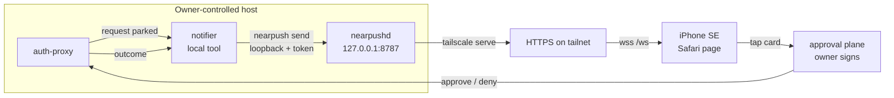
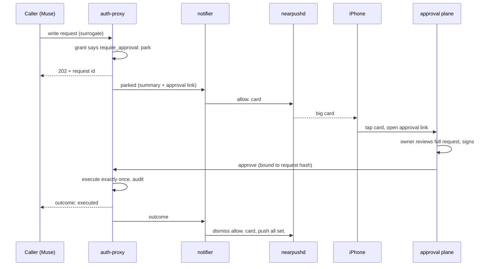

# auth-proxy → nearpushd → iPhone

How [auth-proxy](https://github.com/openabdev/auth-proxy) approval requests are
shown on the iPhone desk display. This is the integration contract from
nearpush#2; the approval mechanism itself is auth-proxy#5 (`require_approval`)
with Muse as the first caller (auth-proxy#6).

nearpush is the **display layer only**. A card can catch the owner's eye and
link to the approval plane; it can never approve anything. Approval happens
only on the approval plane, signed by the owner's key (WebAuthn / device key),
and only auth-proxy executes the request afterwards.

## Architecture



- **auth-proxy** parks a request whose grant says `require_approval` and hands
  a summary to a small local notifier running on the same host.
- **The notifier** is trusted local code, like the hooks: it alone may push
  `allow.` cards, over loopback with the push token. Tailnet viewers can view
  and dismiss cards but can never push one, so a card on the phone always
  originates from the owner's host.
- **The card** carries a one-line summary and the approval-plane link as its
  `--url`. It never carries the request body, a credential, or an approve
  action.
- **The approval plane** is a separate surface (PWA or native app) holding the
  owner's signing key. Tapping the card opens it; nothing about the signature
  or the decision passes through nearpush.

## The contract

One parked request is one card, sender `auth-proxy` (which has a built-in
icon, a shield mark). The notifier keeps the event id that `nearpush send`
prints and follows the request to its outcome:

| auth-proxy event | nearpush action |
|---|---|
| request parked | `nearpush send --sender auth-proxy --app auth-proxy --state allow --title "<one-line summary>" --url "<approval-plane link for this request>"` |
| approved and executed | dismiss the `allow.` card, then `nearpush send --sender auth-proxy --state all_set --title "<summary> — done"` |
| denied | dismiss the `allow.` card (no replacement card; a denial needs no attention) |
| expired with no decision | dismiss the `allow.` card, so a dead request never lingers as if it were actionable |

Dismissal from the notifier uses the loopback path with the push token:

```sh
curl -s http://127.0.0.1:8787/v1/dismiss \
  -H "Authorization: Bearer $(cat ~/.config/nearpush/token)" \
  -H 'Content-Type: application/json' \
  -d "{\"event_id\": <id printed by nearpush send>}"
```

## One approval, end to end



## Non-goals

- No approve or deny control anywhere in nearpush — not on the card, not in
  the drawer, not in any viewer-reachable endpoint. A compromised viewer must
  gain nothing.
- No request payloads on cards beyond a one-line summary. The full request
  lives on the approval plane only.
- No background notification promise: as the README states, nearpush is a
  display, not a notifier. A parked request that nobody sees simply expires
  in auth-proxy, which is the safe outcome.
