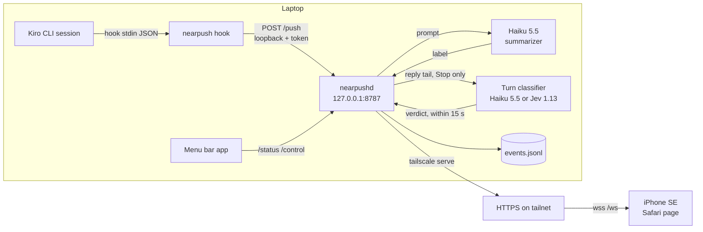
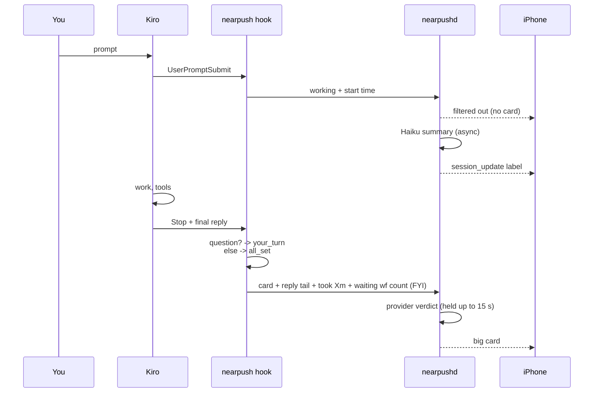

# Kiro CLI → nearpushd → iPhone

How Kiro CLI sessions drive the iPhone desk display.

## Architecture



- **`nearpush hook`** runs on every Kiro hook event, reads the event JSON on stdin, turns it
  into a card, posts it to nearpushd and exits. It always exits 0, prints nothing on
  stdout, gives the daemon under a second and stays quiet when the daemon is down, so it
  never blocks or breaks the agent. `NEARPUSH_DISABLE=1` makes it exit immediately.
- **nearpushd** listens on loopback only. It stores events in
  `~/.local/state/nearpush/events.jsonl`, applies the display filter, broadcasts to
  viewers, and asks the summarizer for a per-session purpose label in the background.
- **Tailscale** (`tailscale serve`) exposes HTTPS to the tailnet only. Requests that arrive
  through it may view (`/`, `/ws`) but are refused on `/push`, `/status` and `/control`.
- **Menu bar app** (`~/Applications/Nearpush.app`) bundles nearpushd and keeps it running
  as the launchd agent `dev.nearpush.agent` (registered with `SMAppService.agent`; it
  survives quitting the menu and launchd restarts it after a crash). It polls loopback
  `GET /status` every 3 s for the icon, status line and recent events, and uses
  `POST /control` for Pause and the "Show on iPhone" state checkboxes.

## One turn



1. **UserPromptSubmit**: the hook records the turn start and sends a `working` event. The
   default filter (`[filter] states = ["all_set", "your_turn", "allow"]` in
   `~/.config/nearpush/config.toml`, or `POST /control {"states": [...]}` at runtime) keeps
   `working` off the iPhone: the event is stored and listed in `/status` but not
   broadcast, so neither the big card nor the history drawer shows it. The start time
   still drives `took Xm`. Events without a state (`nearpush send` without `--state`)
   always show.
2. **Session label**: nearpushd sends the prompt to the summarizer
   (`kiro-cli chat --no-interactive --model claude-haiku-5.5 --trust-tools=`, run with
   `NEARPUSH_DISABLE=1` so it does not trigger the hook again, and with `KIRO_API_KEY`
   read from Keychain service `nearpush-kiro-api-key`). When the label arrives, a
   `session_update` frame updates the card and history rows in place.
3. **Stop** (the turn ended): the hook classifies Kiro's final reply. Kiro's Stop input
   carries only `hook_event_name`, `cwd` and `session_id`, with no reply text
   ([hook docs](https://kiro.dev/docs/hooks/types/), [Kiro#6258](https://github.com/kirodotdev/Kiro/issues/6258)).
   The hook therefore reads the reply from the transcript Kiro CLI writes before the hook
   runs: `~/.kiro/sessions/<workspace-hash>/<session_id>/messages.jsonl`, the last
   `assistant` record with `operationType: "Say"` after the latest `turn_start`
   (`Reasoning` records are skipped). A `response` field on stdin wins if Kiro adds one.
   - **`your turn.`** (white + red) when the reply waits on you, judged on its last 8
     lines outside code blocks: the last line ends with `?`/`？`; or a list of two or
     more options (`1.`, `A)`, `①`) follows an intro line that ends with `?`, or ends
     with `:` and names a choice (option, which, 選, 方案, 哪); or one of the last 3 lines
     has a phrase such as 請選, 要不要, 你決定, 跟我說, 可以嗎, "should I", "which option",
     "let me know", "your call". The question line (redacted, at most 80 characters)
     becomes the detail.
   - **`your turn.`** only from the reply text.
   - **`all set.`** (green) otherwise, with `took Xm`.
   - **Provider verdict.** The hook also sends the redacted reply tail. nearpushd holds the
     card for up to 15 s while the selected provider decides. The provider is `kiro`
     (Haiku 5.5 through kiro-cli, the default), `openrouter` or `typesafe` (Jev 1.13 over
     HTTPS). A verdict replaces the rules verdict above, and its question line or `took`
     text becomes the detail. If the provider fails, its key is missing, or the hold
     expires, the card goes out with the rules verdict and a warning is logged.
     The provider is chosen in the menu bar app's Classifier submenu or in
     `[classifier]` (see the README's *Stop classifier* section).
   The card carries the duration, the session label and the project/branch. The hook
   also sends the session's waiting workflow count (`paused` runs in
   `~/.kiro/sessions/<hash>/workflows/wf_*/workflow-state.json` with `parentSessionId` =
   this session, changed in the last 24 h). It never changes the verdict; nearpushd shows
   it only as a footer `N wf waiting` when the final verdict is `all set.`. Running counts
   are not shown.
4. **Reconnect**: the iPhone reconnects with `since=<last id>` and nearpushd replays what it
   missed; a small note appears if events fell out of the buffer.

## Card fields

| Field | Source |
|-------|--------|
| icon / app | `sender = kiro`, `app = Kiro` |
| session tag | Kiro `session_id` |
| session label | Haiku purpose summary (first prompt, truncated, until it arrives) |
| project | cwd basename + git branch |
| detail | question line (`your_turn`) or `took Xm` (`all_set`) |
| wf count | waiting workflows for this session, on a final `all set.` card only (page footer `1 wf waiting`) |

## Install

1. Install `~/Applications/Nearpush.app` and the matching `~/.local/bin/nearpush` (see
   the README's *Menu bar app* section), and open the app once. It starts nearpushd.
2. Add the global hook file, which applies to every agent and workspace:
   `~/.kiro/hooks/nearpush.json`.

```json
{
  "version": "v1",
  "hooks": [
    { "name": "nearpush-prompt", "trigger": "UserPromptSubmit", "action": { "type": "command", "command": "/Users/<user>/.local/bin/nearpush hook" }, "timeout_ms": 3000 },
    { "name": "nearpush-stop",   "trigger": "Stop",             "action": { "type": "command", "command": "/Users/<user>/.local/bin/nearpush hook" }, "timeout_ms": 3000 },
    { "name": "nearpush-end",    "trigger": "SessionEnd",       "action": { "type": "command", "command": "/Users/<user>/.local/bin/nearpush hook" }, "timeout_ms": 3000 }
  ]
}
```

- `PreToolUse` is optional. It only produces `working` cards (`tool: summary`), so add it
  only if `working` is enabled in the filter.
- Use either this global file or an agent profile's `hooks` array, not both, or each event
  is pushed twice.
- Hooks load when a session starts. Open a new Kiro session after installing.
- Remove the file to turn the integration off.

## Limitations

- Kiro has no "waiting for approval" hook, and `PreToolUse` input does not say whether a
  tool call will prompt, so hooks never produce `allow.`. Use
  `nearpush send --state allow` from another tool if needed.
- The `your_turn` / `all_set` split is a heuristic on the final reply. A casual closing
  question ("要不要我說明一下？") is shown as `your_turn`.
- A Jev verdict is a probability (`noul`) against `threshold`, not a certainty. Jev is
  English-first, so Chinese replies can be misjudged in either direction.
- Each Stop with the `kiro` provider runs one `kiro-cli` call, billed to the Kiro account.
  The `openrouter` and `typesafe` providers bill their own accounts and send the reply
  tail to a third party.
- Workflow step sessions also fire global hooks. The hook skips a session whose
  `session.json` has a `rootConversationId` other than its own id, a
  `_meta.kiro.workflow` object or a `_meta.kiro.serverSession.ownerSessionId`, so only
  the session you talk to notifies. `[hook] include_subagents = true` in config.toml
  turns the skip off. A missing `session.json` counts as a top-level session.
- iOS suspends Safari in the background. Keep the page in front (Auto-Lock: Never, or
  Guided Access) for live updates; missed events replay on return.
